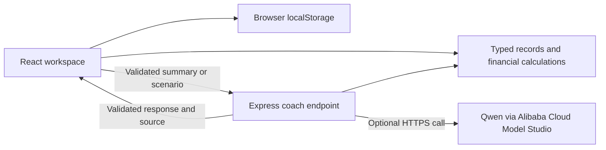

# Architecture

UntungLah runs as a React application with a local Express companion API. During development Vite serves the web interface and forwards `/api` requests. After a production build, Express serves `dist` and the API on the same origin. Both entry points are intended for the local hackathon demo.

| Source | Responsibility |
| --- | --- |
| `src/domain.ts` | Profile, record and progress schemas, persistence boundary, sample data and pure financial operations |
| `src/lessons.ts` | Six lessons, worked examples, static quiz questions and explanations |
| `src/coach-contract.ts` | Shared request and response validation for coaching |
| `server/coach.ts` | Deterministic fallback, provider client and structured reply normalization |
| `server/index.ts` | API request limits, routing and serving of the production frontend |

## Data and calculation boundaries

The typed storage boundary reads and writes one document per workspace. Each contains a profile with the primary product, a sample marker, records, quiz attempts and goals. The demo and personal workspaces use distinct keys, so a demo reset affects only sample records and progress. Persistent records contain IDs, Malaysian calendar dates and categories. Sales keep their quantity and unit price. Cash outflows keep an explicit amount.

A recorded sale contributes its quantity multiplied by its selling price. Recorded purchases and operating expenses are subtracted once for the cash surplus. In a simulation the estimated variable cost is calculated from cost per unit and assumed units sold. The simulator estimates gross contribution from those inputs and has no dependency on recorded cash outflows.

The demo seeds Mak Cik’s Nasi Lemak from the curriculum: one 50-pack sale at RM4.50, a RM80 ingredient purchase, RM15 transport and RM20 stall rental, with a RM2.20 estimated unit cost. The dashboard shows a RM110 cash surplus, while the estimated operating profit is RM80 (RM225 − 50 × RM2.20 − RM35). The difference teaches that cash and profit differ. `src/calculators.ts` holds the lesson calculators; `src/lessons.ts` holds the curriculum content.

Local browser storage keeps setup small and works without an account. Storage belongs to a browser and origin, so the Vite and production URLs may show separate data. A future multi-user version can replace repository persistence while preserving the domain calculations and UI contracts.
